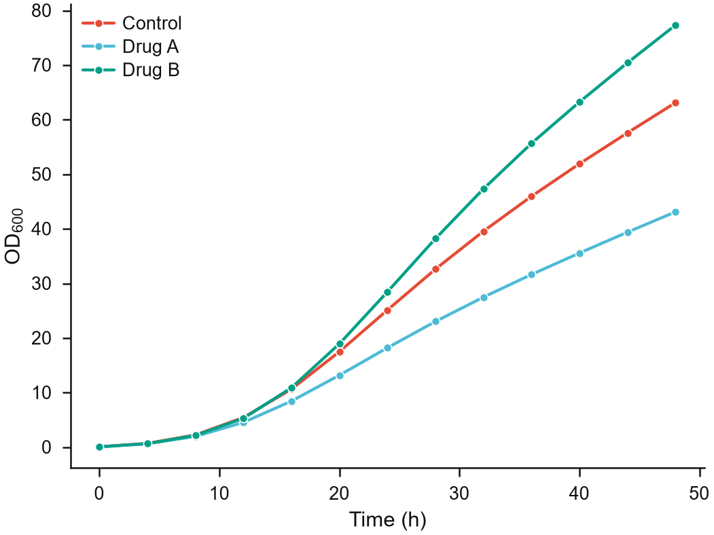
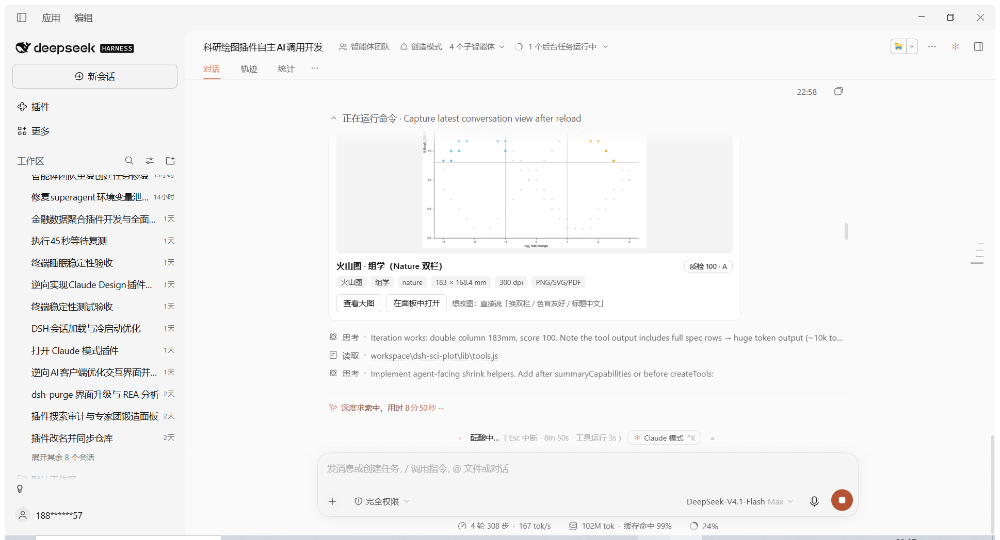
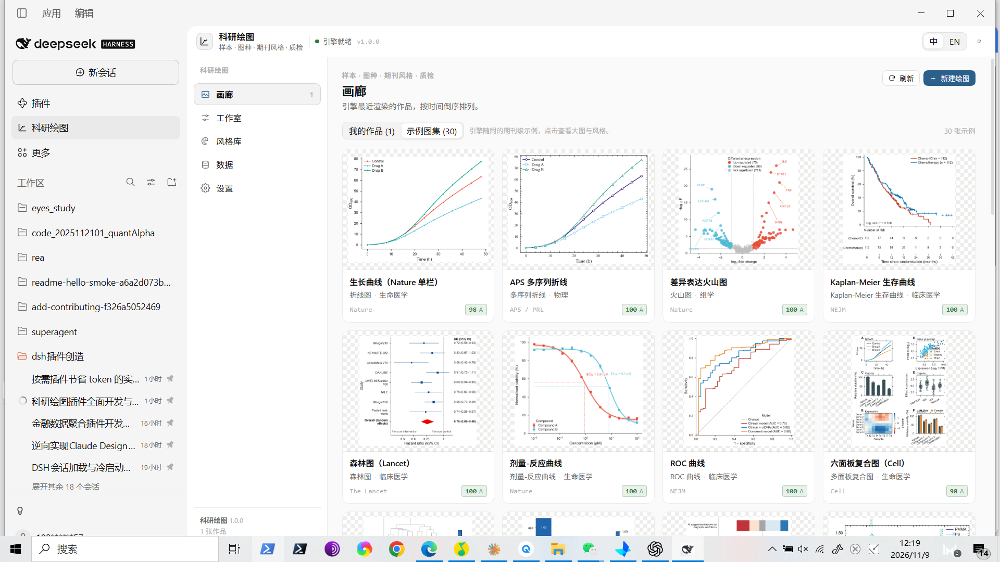
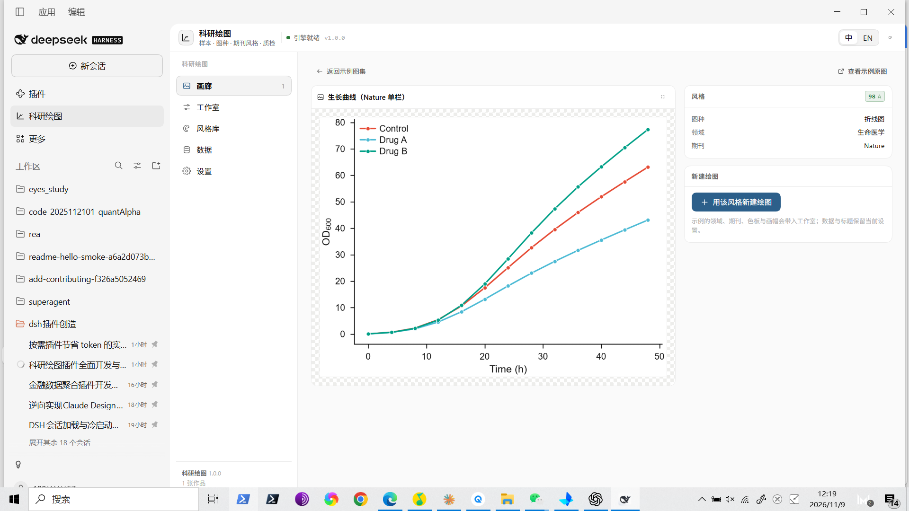
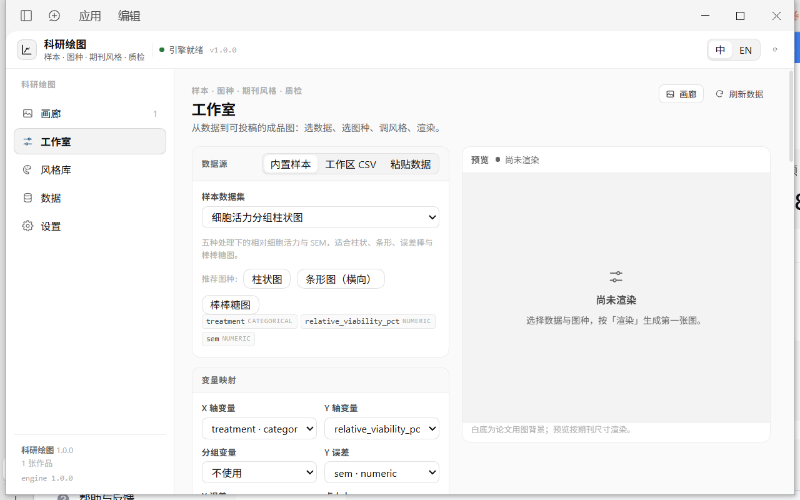

# 科研绘图 · dsh-sci-plot

> 把「能出图」变成「能投稿」。12 个学科预设 × 16 种期刊风格 × 71 个图种 × 色盲安全配色 × 矢量导出 × 投稿就绪度质检，面板与 Agent 工具一体。

dsh-sci-plot 是 DeepSeek Harness 的科研绘图插件：左侧栏「科研绘图」面板用于浏览、出图、调风格、导出；同时提供 `sci_plot_*` 工具，让 Agent 在对话里直接用一条 spec 生成顶刊级图表。v1.1 起，图会以**会话内联图卡**的形式直接出现在回答里，AI 自主判断何时出图、选图种和风格，并用一句话继续迭代。



## 会话内联出图（v1.1）



- **自主触发**：数据分析、论文/报告/汇报、明确图表请求时主动出 1 张主图；代码、闲聊、纯数值问题不出图。
- **一次调用出图**：`sci_plot_auto` 内部完成画像 → 图种/映射 → 学科/期刊风格 → 渲染 → 质检（≥90 才交付，低于门槛自动修复一次）。
- **图卡直接进会话**：缩略图 + 图种/学科/期刊/尺寸/DPI/格式 + 质检徽标 + 选型理由 + 备选图种，可查看大图或跳面板精修；图卡只做 UI 渲染，不消耗模型图像 token。
- **一句话迭代**：图内记 `figureId` 与 spec，说「换双栏 / 色盲友好 / 标题中文」只改对应字段重渲染；`rewind` 可回到上一版。
- **表格图注**：回复内嵌 Markdown 图 + 一行图注 + 一句结论，进程折叠时图也仍然可见。
- **xlsx 直读**：工作区 `.xlsx` 直接出图（自带 OOXML 解析，读第一个非空工作表，无 openpyxl/pandas 依赖）。
- **交付与打包**：`purpose` 预设（submission / slides / web）、`reveal` 打开文件夹、`sci_plot_pack` 多图打成一个 ZIP（含 manifest 与质检分）。
- **偏好与风格锁**：`sci_plot_preferences` 让 AI 记住「以后默认 IEEE 双栏 600dpi」；`styleFrom` 让一组配图共用同一套风格。
- **面板 ↔ 对话**：作品详情「在对话中继续」一键复制迭代指令并回到对话，AI 读取该图 spec 接着改。

## 界面







## 亮点

- **71 个图种，8 大族**：基础 / 统计分布 / 生物医学 / 物理化学 / 工程信号 / 经济金融 / 机器学习 / 复合排版。火山图、KM 生存曲线、森林图、剂量-反应、聚类热图、XRD、CV、TGA、Bode、扇形图、Taylor 图、混淆矩阵等专业图种开箱即用。
- **13 个学科预设**：生命医学、临床医学、组学、化学、材料、物理、工程与信号、地球与环境、经济金融、心理与社科、计算机与 AI、数学与统计、通用科研。每个预设决定字体、刻度方向、边框、网格、线宽、默认色板与色标。
- **16 种期刊风格**：Nature / Science / Cell / NEJM / The Lancet / JAMA / PNAS / IEEE / ACS / RSC / APS / AGU / Elsevier / Springer / APA / NeurIPS。按真实作者指南内置单/双栏物理宽度（如 Nature 89/183 mm、IEEE 3.5/7.16 in、Science 55/120/183 mm）。
- **色盲安全**：Okabe-Ito、Paul Tol、ColorBrewer、NPG / Science / Lancet / NEJM / JAMA 等 17 套分类色板与 27 套连续/发散/循环色标；插件对每次渲染做 CVD 模拟与 Lab 色差检查，把「哪两种颜色在色盲视角下过近」直接写进质检报告。
- **论文级导出**：PNG（300/600/1200 dpi）、SVG、PDF/EPS（Type 42 字体，Illustrator/Inkscape 可编辑）、TIFF（LZW，投稿系统）、JPG。按期刊物理尺寸出图，不靠放大位图凑版面。
- **投稿就绪度质检**：每张图自动给 0–100 分与 A/B/C/D 等级，逐项检查矢量输出、分辨率、最小字号、字体嵌入、色盲安全、图例、坐标轴变量/单位、空子图、色标标签、刻度密度、过度绘制、图幅利用率、缺字回退。改完再渲染，分数即时更新。
- **51 套内置样本数据**：覆盖 12 个学科，带字段类型、默认映射与推荐图种；没有数据也能先看到专业效果。
- **工作区数据直读**：CSV / TSV / JSON，自动字段画像（类型、缺失、范围、水平）并给出图种推荐与字段映射。
- **面板 + 工具同源**：面板里调的每个参数都是一份 spec；Agent 用同一份 spec 渲染，两边看到同一张图、同一份质检。

## 安装与启用

插件已随 Harness 安装（本地 bundle），在侧边栏点击「科研绘图」即可。若需重新安装/升级：

```text
plugin_manager action=install_bundle target=F:\dsh插件创造\workspace\dsh-sci-plot
```

依赖：Node ≥ 22；Python ≥ 3.11，需 `numpy`、`matplotlib`（推荐再装 `scipy`、`pillow`）：

```powershell
python -m pip install numpy matplotlib scipy pillow
```

插件会自动发现解释器：`config.pythonPath` → 环境变量 `SCIPLOT_PYTHON` → `python` / `python3` / `py -3` → DSH 托管运行时 → 常见 conda/Python 安装路径。找不到时调用 `sci_plot_doctor` 会给出具体修复步骤。

可选配置（`cordis.patch.yml` 的 row config）：

```yaml
config:
  pythonPath: ""            # 指定 Python 解释器（留空自动发现）
  workspaceDir: ""          # 数据发现目录（留空 = Harness 进程工作目录）
  defaultDomain: life-science
  defaultJournal: nature
  defaultPalette: okabe-ito
  defaultFont: arial
  defaultSize: single
  defaultDpi: 300
  maxFigures: 240
```

## Agent 工作流

```text
sci_plot_capabilities  →  选图种 + 学科/期刊预设（detail:"full" 含每个图种的参数 schema）
sci_plot_inspect_data  →  给数据画像 + 推荐图种 + 映射（支持 data.path 或内置 sample）
sci_plot_render        →  用 spec 出图，返回预览路径、尺寸与质检分数
sci_plot_export        →  按投稿要求导出 SVG/PDF/EPS/TIFF、改期刊/宽度/DPI
sci_plot_figures       →  列表 / 取回 spec / 删除
sci_plot_doctor        →  引擎、字体、目录诊断
```

最小渲染示例：

```json
{
  "kind": "volcano",
  "data": {
    "sample": "bio_volcano_de",
    "mapping": { "x": "log2fc", "y": "neglog10_p", "label": "gene" }
  },
  "style": { "domain": "omics", "journal": "nature" },
  "labels": { "x": "log$_2$ fold change", "y": "$-$log$_{10}$ $P$" },
  "options": { "fc_cut": 1, "p_cut": 0.05, "label_top": 5 }
}
```

工作区 CSV：

```json
{
  "kind": "line",
  "data": {
    "path": "F:/data/measurements.csv",
    "mapping": { "x": "time_h", "y": "od600", "group": "condition" }
  },
  "style": { "domain": "life-science", "journal": "nature", "dpi": 600 }
}
```

## spec 速查

| 字段 | 说明 |
|---|---|
| `kind` | 图种 id，见 `sci_plot_capabilities` |
| `data.sample` | 内置样本 id（51 套） |
| `data.path` | 绝对路径 CSV/TSV/JSON |
| `data.series` | `[{name,x,y,yerr?,xerr?,size?,categories?}]` |
| `data.rows/columns/mapping` | 长表 + 映射；`mapping` 支持 `x,y,group,yerr,xerr,size,label,time,event,row,col,value,p,fc,phase,chr,...` |
| `data.matrix` | 二维矩阵（热图/相关矩阵） |
| `style` | `domain, journal, palette, cmap, font, size, width_mm, height_mm, height_ratio, dpi, grid, legend, ticks, minor, spines, line, errorbar, font_size, transparent, background` |
| `labels` | `x, y, y2, z, title, subtitle, legend, colorbar` |
| `options` | 图种专属参数（动态表单/工具 schema 同源） |
| `output.formats` | `png, svg, pdf, eps, tiff, jpg` |

物理宽度预设：`single` / `double` / `wide` / `narrow` / `slide` / `square` / `golden` / `custom`；选中期刊后按该刊真实单双栏宽度解析。

## 学科与期刊

学科预设决定「怎么画」，期刊预设决定「按谁家的规矩画」。二者可自由组合（例如 `domain: chemistry` + `journal: nature`），分类色板、连续色标、字体、画幅都可单独覆盖。

| 学科 | 默认气质 | 代表图种 |
|---|---|---|
| life-science 生命医学 | 开放坐标轴、细线小标记、Okabe-Ito | 生长曲线、火山、KM、剂量-反应 |
| clinical 临床医学 | NEJM/Lancet 式可读性优先 | KM、森林、ROC、校准、Bland-Altman |
| omics 组学 | 感知均匀色标、紧凑标注 | 火山、MA、曼哈顿、聚类热图、PCA/t-SNE、dot plot |
| chemistry 化学 | 闭合框、内向刻度、柔和配色 | 红外/拉曼、循环伏安、TGA |
| materials 材料 | 主次刻度、相位图、3D | XRD、等值线、3D 表面、空间热图 |
| physics 物理 | Times、内向主次刻度 | 折线、误差棒、极坐标、Taylor |
| engineering 工程与信号 | 浅网格、闭合框 | Bode、Nyquist、PSD、波形、控制图、帕累托 |
| earth 地球与环境 | 方向性网格、大地色 | 风玫瑰、等值线、时间序列 |
| economics 经济金融 | Times、横向参考线 | 时间序列、扇形图、瀑布图、龙卷风、漏斗 |
| social 心理与社科 | APA 气质、低饱和 | 李克特、分组柱、箱线、雨云 |
| ml 计算机与 AI | 清爽网格、略粗曲线 | 训练曲线、混淆矩阵、特征重要性、embedding |
| math 数学与统计 | STIX 公式、克制留白 | 分布、ECDF、QQ、相关矩阵 |

## 图种一览（71）

- **基础（14）**：line, multiline, step, scatter, bubble, bar, bar_grouped, bar_stacked, bar_h, lollipop, errorbar, area, area_stacked, pie
- **统计分布（15）**：histogram, hist2d, box, violin, raincloud, strip, ridge, density, ecdf, qq, corr_heatmap, pairplot, regression, residual, likert
- **生物医学（15）**：volcano, ma, manhattan, km_survival, forest, roc, pr_curve, calibration, bland_altman, dose_response, cluster_heatmap, pca, tsne, dot_plot, gsea_bar
- **物理化学（11）**：spectra, xrd, cv, tga, contour, heatmap, surface3d, scatter3d, polar, windrose, taylor
- **工程信号（6）**：bode, nyquist, psd, waveform, pareto, control_chart
- **经济金融（5）**：time_series, fan_chart, waterfall, tornado, funnel
- **机器学习（4）**：training_curves, confusion_matrix, feature_importance, embedding
- **复合排版（1）**：multi_panel（最多 6 面板，A/B/C 编号，行/列布局）

## 面板

- **画廊**：作品网格（缩略图、图种、领域、物理尺寸、DPI、质检徽标），详情页可缩放看图、逐项质检清单、按期刊/DPI/宽度导出、删除、在文件夹显示、回工作室调参。
- **工作室**：数据源（内置样本 / 工作区 CSV / 粘贴数据）→ 图种（可搜索、按族分组、动态参数控件）→ 风格（学科 / 期刊 / 色板 / 色标 / 字体 / 画幅 / DPI / 网格 / 图例 / 透明）→ 坐标轴与标题 → 导出格式 → 一键渲染，右侧即时预览与分数。
- **风格库**：13 个学科卡片（描述、推荐图种、默认色板条）、16 个期刊规格、分类/连续色板、画幅预设。
- **数据**：51 套样本与工作区数据文件，字段类型/行数/默认映射/推荐图种，支持预览与「用它绘图」。
- **设置**：引擎状态（解释器、matplotlib/numpy/scipy、CJK 字体）、默认风格、数据/画廊目录、诊断。

## 数据与隐私

所有渲染、数据读取、质检都在本机完成，不发起网络请求。作品保存在 `~/.dsh/sci-plot/`（index.json + 每图目录），面板可一键定位；版本上限默认 240 张，超出自动清理最旧作品。

## 测试

```powershell
# 引擎全图种矩阵（71 个 kind，逐个渲染 + 质检）
cd engine; python -m sciplot.cli selftest

# 引擎单元测试（色板/主题/spec/helpers/渲染矩阵/CJK，stdlib unittest）
cd engine; python -m unittest tests.test_core -v

# Host 单元测试（数据解析/存储/服务/路由）
node --test test/unit/host.test.mjs
node --test test/unit/client.test.mjs

# 真实引擎集成测试
node --test test/integration/engine.test.mjs

# 已安装面板的端到端测试（需要 Harness 在跑）
node --test test/integration/live-panel.test.mjs

# 重建示例图集与兜底能力清单
node scripts/build-gallery.mjs
```

最近一次全量结果：引擎 selftest **71/71 通过**（最低 98 / 均分 99.7）；示例图集 **30/30 渲染成功**（2.98 MB）；Host 单测 19/19、面板单测 27/27、引擎单测 26 项全绿。

## 项目结构

```
dsh-sci-plot/
├─ index.js                # Host 入口：工具、prompt、面板路由
├─ lib/                    # 引擎桥、数据加载、作品库、服务、工具、HTTP 路由
├─ engine/
│  ├─ sciplot/             # Python 引擎：主题、色板、字体、spec、上下文、质检、导出、CLI
│  │  └─ renderers/        # 71 个图种（按族拆模块）
│  ├─ samples/             # 51 套内置样本（CSV + JSON sidecar）
│  ├─ demo_catalog.json    # 30 张策展示例图
│  └─ tests/               # 引擎单元测试
├─ src/client/             # 面板源码分片（按文件名拼接）
├─ client.js               # 面板构建产物
├─ assets/gallery/         # 示例图集（PNG + manifest）
├─ assets/capabilities.json# Python 不可用时的只读能力清单
└─ test/                   # Host/客户端/集成测试
```

## 已知限制

- `surface3d` / `scatter3d` 的 3D 画布背景与网格样式由 matplotlib 统一控制，无法逐轴自定义。
- `taylor` 需要 `correlation` 与 `std_ratio` 两列；`rmsd` 列仅作参考。
- `windrose` 的风速分层上界按数据最大风速取整，`≥10` 档为开区间近似。
- `funnel` 的期望区间使用合并率 ±n·SE 正态近似。
- `multi_panel` 六面板渲染约 3 s（复合图 + 三格式导出），其余图种通常 < 2 s。
- 无 SciPy 时，`dose_response` 只画拟合曲线不给置信带；`cluster_heatmap` 使用 NumPy 降级实现。
- 中文标签依赖系统 CJK 字体（Windows 上 Microsoft YaHei/SimHei 可用）；无 CJK 字体时质检会报告缺字风险。

## License

MIT © YansongG-HKU
